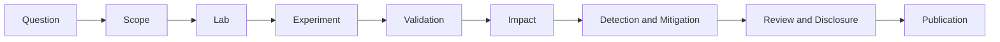

A security investigation often begins with a weak signal: an unexpected response, a suspicious process tree, a protocol edge case, or a mismatch between documentation and observed behavior. The professional part starts after that moment.

The goal is not merely to make the behavior happen twice. The goal is to identify the conditions that cause it, preserve evidence, challenge alternative explanations, and communicate the result without overstating it.

## The workflow



The stages are sequential enough to provide discipline, but research is iterative. A failed validation may change the threat model; a mitigation test may reveal that the original impact was incomplete.

## 1. Turn the observation into a question

Begin with a falsifiable statement.

Weak:

> The service looks vulnerable.

Stronger:

> Can an unauthenticated network client cause version X of the service, under its default configuration, to disclose data belonging to another session?

The stronger version identifies the actor, boundary, affected version, configuration, action, and expected consequence. It can be disproved, which is exactly why it is useful.

Record competing explanations before testing. The apparent cross-session response might be a browser cache, proxy behavior, stale test data, or an error in instrumentation. Alternative hypotheses reduce confirmation bias.

## 2. Define scope and authorization

Write the scope down before touching the target:

- systems and accounts covered by authorization;
- source and destination networks;
- allowed techniques and prohibited actions;
- test window and stop conditions;
- data-handling and retention requirements;
- disclosure contact and escalation path.

For a local lab, scope still matters. It distinguishes the tested component from shared infrastructure and prevents background traffic from contaminating evidence.

## 3. Capture the environment as data

An environment description should be machine-readable where practical. A small manifest is more useful than “tested on Linux.”

```yaml
investigation: example-session-isolation
captured_at: 2026-08-25T19:00:00+02:00
target:
  product: example-service
  version: 1.4.2
  image_digest: sha256:REDACTED
configuration:
  authentication: disabled
  reverse_proxy: none
client:
  os: Debian 13
  tool_version: 8.15.0
network:
  topology: isolated-lab
  packet_capture: enabled
```

Useful details include exact versions, package or container hashes, configuration deltas, clock synchronization, network topology, and the commands used to start each component.

Never place live credentials in a manifest. Use placeholders and document how test secrets are provisioned.

## 4. Design one-variable experiments

Change one meaningful condition at a time. If authentication, proxying, payload shape, and target version all change together, the result cannot identify which condition matters.

A compact experiment matrix helps:

| Run | Version | Authentication | Input class | Result |
|---|---:|---|---|---|
| A | 1.4.2 | Off | Control | Expected behavior |
| B | 1.4.2 | Off | Candidate | Behavior reproduced |
| C | 1.4.2 | On | Candidate | Not reproduced |
| D | 1.4.3 | Off | Candidate | Not reproduced |

Controls are not decoration. A negative control checks that the instrumentation is not producing the signal by itself. A version or configuration comparison helps establish the actual boundary of the finding.

## 5. Preserve evidence with provenance

Collect the smallest set of artifacts that independently supports the claim:

- client request and response transcripts;
- server and application logs;
- network captures when protocol behavior matters;
- process, file, or registry telemetry when host behavior matters;
- screenshots only as supporting context;
- hashes for immutable artifacts.

Maintain an evidence ledger:

| Artifact | Source | Clock | Integrity | Sanitized copy |
|---|---|---|---|---|
| `server.log` | target VM | UTC | SHA-256 recorded | Yes |
| `trace.pcapng` | sensor interface | UTC | SHA-256 recorded | Yes |
| `request.txt` | test client | UTC | Git-tracked | Yes |

Raw artifacts may contain tokens, names, internal addresses, or personal data. Keep originals restricted and publish only the minimum sanitized evidence needed to evaluate the finding.

## 6. Reproduce from a clean state

Restarting the application is not always a clean state. Rebuild the environment from a known snapshot or infrastructure definition, then rerun the experiment using written instructions.

Ideally, a second person—or at least a separate machine and fresh session—should reproduce the observation. Record unsuccessful reproductions too. Intermittency may reveal a race condition, hidden dependency, or invalid assumption.

The reproduction guide should state both:

1. the expected positive signal; and
2. the expected control behavior.

Without the second item, readers cannot distinguish a real result from a generally noisy system.

## 7. Separate evidence, interpretation, and impact

Structure the conclusion in layers:

- **Observation:** what the instrumentation recorded.
- **Interpretation:** the mechanism that best explains the observation.
- **Security property:** the boundary that appears to fail.
- **Impact:** what a realistic actor can gain under stated prerequisites.
- **Uncertainty:** what remains untested or unknown.

Avoid jumping directly from a crash to remote code execution, or from an unusual response to data compromise. Severity follows demonstrated capability and realistic conditions—not the most dramatic possible story.

## 8. Test detection and mitigation

A useful report should help defenders answer two different questions.

**Can we see it?** Identify stable telemetry and evaluate false positives. Payload strings are often fragile indicators; behavioral sequences, authorization mismatches, or unusual state transitions may generalize better.

**Can we stop it?** Test the vendor fix or proposed hardening under the same conditions as the original result. A mitigation is not validated merely because the triggering request now returns a different status code.

Document compensating controls separately from root-cause fixes.

## 9. Coordinate disclosure

Before contacting a maintainer, prepare a concise private report containing:

- summary and affected versions;
- prerequisites and realistic impact;
- deterministic reproduction steps;
- sanitized evidence;
- suggested remediation direction;
- a proposed communication timeline.

Do not publish exploit details while users have no reasonable path to remediation. Preserve a timeline of acknowledgements, validation, fixes, and release decisions for the eventual write-up.

## Publication checklist

Before publishing, I want each substantial investigation to pass this checklist:

- [ ] Authorization and scope are recorded.
- [ ] Versions and configuration are explicit.
- [ ] The claim is falsifiable and appropriately narrow.
- [ ] Positive and negative controls are documented.
- [ ] Evidence is timestamped, hashed where useful, and sanitized.
- [ ] Reproduction starts from a clean state.
- [ ] Impact does not exceed the demonstrated result.
- [ ] Detection and mitigation claims were tested.
- [ ] Limitations and failed attempts are included.
- [ ] Disclosure obligations are complete.

Reproducibility does not make a finding automatically correct. It makes the path from question to conclusion visible enough to challenge—and that is what turns a technical observation into research.
