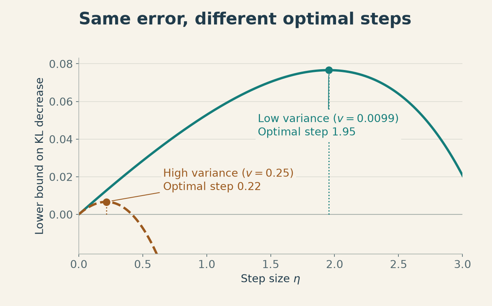
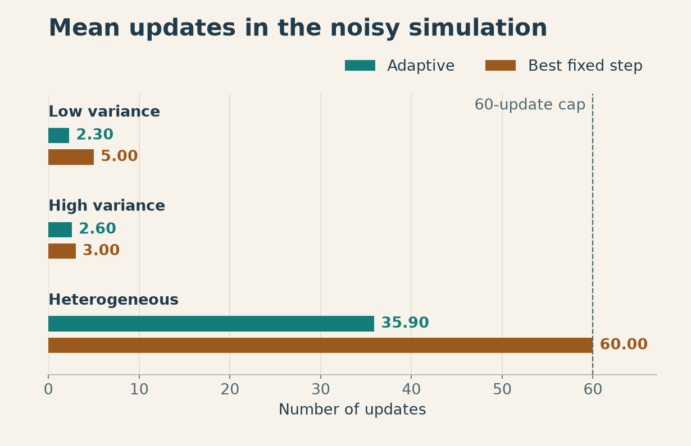

*How a public estimate learns from a private measurement, and why the size of the correction matters.*

Imagine a hospital's statistical model puts the prevalence of a complication at 1%. In the database, it's 7%. For a second question, the model predicts 50% and the database says 56%. Both errors are six percentage points. Should the model make the same correction twice?

In [the previous post](), I looked at what happens when a service keeps the records private but answers many questions about them. That led me to Private Multiplicative Weights (PMW) and to the question behind this research. **When a private measurement tells us the public model is wrong, how far should we move it?**

## A public model and a private check

Private Multiplicative Weights, introduced by Moritz Hardt and Guy Rothblum, keeps a public probability distribution $$h_t$$ over a finite universe of possible records.[^hardt] It starts from a public prior $$r$$ that puts positive mass on every record type. The actual dataset has empirical distribution $$p$$. An analyst asks a bounded query $$q_t:\mathcal X\to[0,1]$$, such as an indicator of whether a record has the complication. The model predicts $$\mu_t=\mathbb E_{h_t}[q_t]$$ and the empirical answer is $$a_t=\mathbb E_p[q_t]$$.

Sparse Vector privately screens the absolute gap $$e_t=\lvert\mu_t-a_t\rvert$$ against a noisy threshold. On an easy round, the mechanism answers with $$\mu_t$$ and keeps the model as it is. On a difficult round, it releases a Gaussian-noised answer $$y_t$$ and uses it to correct the model. The interaction stops after the $$C$$th difficult round or when all queries have been processed.

Here, neighboring datasets have the same size $$n$$ and differ by one replaced record. For a fixed query and hypothesis, replacing that record changes both the empirical answer and the screening gap by at most $$1/n$$. Between corrections, the hypothesis is fixed. A fresh instance of AboveThreshold handles that phase, including the first crossing if one occurs, at a privacy cost of $$\varepsilon_{\mathrm{sv}}/C$$. Each crossing triggers a Gaussian release calibrated to $$(\varepsilon_{\mathrm{num}}/C,\delta/C)$$, with $$0<\varepsilon_{\mathrm{num}}/C<1$$ for the paper's calibration.

There are at most $$C$$ screening phases and $$C$$ numerical releases, so adaptive composition gives $$(\varepsilon_{\mathrm{sv}}+\varepsilon_{\mathrm{num}},\delta)$$-DP for the transcript, including its stopping time. The update uses the current public hypothesis, the query and the noisy answer, so it is post-processing.[^dworkroth]

## The same error can call for two different steps

Let $$v_t=\operatorname{Var}_{h_t}(q_t)$$ be the variance of the query under the current model. An indicator query has variance $$\mu_t(1-\mu_t)$$. In the opening example, the complication has variance $$0.0099$$ under the model, while the second query has variance $$0.25$$.

PMW-Bernstein takes the observed gap $$\widehat e_t=\lvert\mu_t-y_t\rvert$$ and chooses the step size

$$
\eta_t=\log\!\left(1+\frac{\widehat e_t}{v_t}\right).
$$

It multiplies each weight $$h_t(x)$$ by $$\exp(-\eta_t\widehat s_t q_t(x))$$, where $$\widehat s_t=\operatorname{sign}(\mu_t-y_t)$$, and renormalizes. For a complication the model underestimates, the update increases the weight of records with that complication. With a measured gap of $$0.06$$ in both examples, the steps are about $$1.95$$ and $$0.22$$. If $$v_t=0$$, the step is zero. Full support means the query is then constant on the whole universe and the true gap is zero too.

_Figure 1. The two curves show the potential lower bound for the opening example, with the true error fixed at 0.06. The dots mark the step that maximizes each bound._

## Where the logarithm comes from

We measure progress with the Kullback–Leibler divergence $$\Phi_t=\mathrm{KL}(p\Vert h_t)$$. If the noisy answer points in the correct direction, taking the log of the weight update shows that a step of size $$\eta$$ reduces the potential by the linear gain $$\eta e_t$$ minus the log moment-generating function of the centered, signed query. That centered query has mean zero, variance $$v_t$$ and absolute value at most one. In the exponential series, each term of order two or higher can be bounded using its second moment. This gives the Bernstein-style bound

$$
\begin{gathered}
\Phi_t-\Phi_{t+1}\ge L_t(\eta),\\
L_t(\eta)=\eta e_t-v_t(e^\eta-\eta-1).
\end{gathered}
$$

The derivative is $$e_t-v_t(\exp(\eta)-1)$$. When $$v_t>0$$, it decreases strictly with $$\eta$$ and vanishes at $$\log(1+e_t/v_t)$$. This is the best step for the lower bound in Figure 1. In the mechanism we can only plug in the noisy estimate, so the proof also has to allow for some error in that estimate.

Suppose the sign is correct and the measured gap lies between $$e_t/2$$ and $$3e_t/2$$. Write $$w=v_t/e_t$$ and $$\rho=\widehat e_t/e_t$$. The normalized bound $$L_t(\eta_t)/e_t$$ becomes

$$
(1+w)\log(1+\rho/w)-\rho.
$$

Its derivative with respect to $$\rho$$ is $$(1-\rho)/(w+\rho)$$, so the worst case is at one of the two endpoints. The inequality $$\log(1+u)\ge 2u/(2+u)$$ shows that the endpoint at $$\rho=1/2$$ gives the smaller value and bounds it below by $$3/[8(w+1)]$$. This gives the one-step guarantee

$$
\Phi_t-\Phi_{t+1}\ge\frac38\frac{e_t^2}{v_t+e_t}.
$$

## When the update count improves

The potential is nonnegative and stays unchanged on easy rounds. Adding the one-step bounds over the update rounds $$U$$ gives

$$
\sum_{t\in U}\frac{e_t^2}{v_t+e_t}
\le\frac83\,\mathrm{KL}(p\Vert r).
$$

To use this inequality for the private mechanism, set the nominal screening threshold to $$3\alpha/4$$. If every threshold and test noise draw has magnitude at most $$\alpha/8$$, easy rounds have error at most $$\alpha$$ and difficult rounds have $$e_t\ge\alpha/2$$. If all Gaussian measurement noises also have magnitude at most $$\alpha/4$$, the difficult-round answers are accurate and their updates meet the sign and relative-error conditions. The Laplace and Gaussian tails control the probability of this joint event.

For any bounded query, $$v_t+e_t\le 1/4+1=5/4$$. Since difficult rounds have $$e_t\ge\alpha/2$$ on the joint event, this gives a **quadratic** bound in $$1/\alpha$$.

$$
\lvert U\rvert\le\frac{40}{3}\frac{\mathrm{KL}(p\Vert r)}{\alpha^2}.
$$

If $$v_t\le B e_t$$ throughout the updates, the denominator is at most $$(B+1)e_t$$. Each difficult round then uses up a quantity proportional to its error, and the bound becomes **linear** in $$1/\alpha$$ for fixed $$B$$.

$$
\lvert U\rvert\le\frac{16}{3}(B+1)\frac{\mathrm{KL}(p\Vert r)}{\alpha}.
$$

For an indicator query that the model underestimates by a factor of at least $$1+\lambda$$, we have $$e_t\ge\lambda\mu_t$$ and $$v_t\le\mu_t$$, giving $$B=1/\lambda$$ on that round. The faster bound needs a common $$B$$ across all updates.

To guarantee that the mechanism can keep answering through the full query sequence on this event, a sufficient cutoff is strictly greater than the relevant bound, using public upper bounds in place of private quantities. For a uniform prior, $$\log\lvert\mathcal X\rvert$$ bounds the initial KL divergence. A smaller justified cutoff lowers the noise scales in our accounting. The linear bound alone gives no way to choose that smaller cutoff without a justified bound on $$B$$.

## What happened in the simulations

We compared the adaptive rule with the best fixed step from $$\{0.25,0.5,1,2\}$$ on three synthetic query pools over 128 possible record types. Success meant that the final hypothesis answered **every query in its pool** within $$\alpha=0.03$$, with a cap of 60 updates.

_Figure 2. Mean update counts over 30 runs per workload in the noisy simulation, from Table IV of the paper. In the mixed workload, the fixed step exhausted the update budget in all 30 runs._[^rerun]

Both rules reached the target in all 30 noisy runs in the low- and high-variance workloads. In the heterogeneous workload, the adaptive rule reached it in 30 of 30 runs and the fixed rule in 0 of 30. The high-variance runs were close, and with no perturbation the fixed step had a lower final maximum error there, even though it took one more update.

The simulator picked the current worst query using exact errors and added noise at fixed stress-test levels. That setup lets us compare the two update rules under the same conditions. Its results describe convergence on synthetic query pools. The privacy claim and the accuracy of answers throughout an adaptive transcript come from the mechanism and its analysis.[^simulator]

What brought me back to the hospital example was the difference between knowing that a model is wrong and knowing how to correct it. The error tells us how far the prediction missed. The variance, computed from the public hypothesis, tells us how much progress we can guarantee from a correction in the right direction.

## References and further reading

[^hardt]: Moritz Hardt and Guy Rothblum (2010), [*A Multiplicative Weights Mechanism for Privacy-Preserving Data Analysis*](https://www.microsoft.com/en-us/research/publication/a-multiplicative-weights-mechanism-for-privacy-preserving-data-analysis/).
[^dworkroth]: Cynthia Dwork and Aaron Roth (2014), [*The Algorithmic Foundations of Differential Privacy*](https://www.cis.upenn.edu/~aaroth/Papers/privacybook.pdf), especially Sections 3.5, 3.6 and 4.2 and Appendix A.
[^simulator]: *A Bernstein-Type Variance-Adaptive PMW Mechanism for DP Query Release*, Sections VII–XII. See the [uchiDP comparison script](https://github.com/0xuchihamabben/uchiDP/blob/20bd14ddaefb20ed0d22650f631f0dabad50c4cd/uchidp/research/pmw_compare.py) and the [earlier theoretical report](https://github.com/0xuchihamabben/pmw-bernstein).
[^rerun]: A rerun using NumPy 2.4.3 reproduced the other five counts in the figure and all the success rates. For the adaptive rule in the noisy high-variance workload it gave 2.57 mean updates and 0.0148 mean final maximum error, compared with 2.60 and 0.0157 in Table IV.
